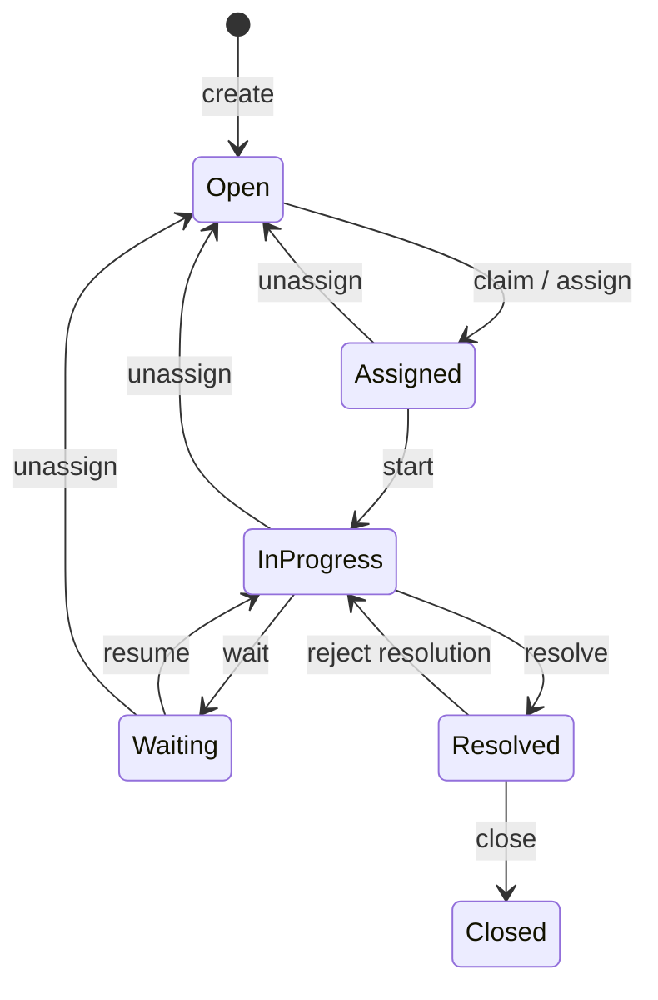

# Service Desk API

A portfolio-grade ASP.NET Core API for the complete service-desk ticket workflow: authenticated request creation, technician assignment and work, administrator resolution review, comments, history, and bounded user administration.

## Highlights

- Three production projects with inward dependencies: `Api -> Core`, `Api -> Infrastructure`, `Infrastructure -> Core`.
- Core-owned domain state machine and application use cases with purpose-specific persistence ports.
- PostgreSQL persistence with direct read projections, immutable audit records, and optimistic ticket concurrency.
- HS256 JWT authentication plus a database-backed active-user/role check on every protected request.
- Role-aware ticket visibility that conceals inaccessible employee tickets as `404`.
- Serializable administrator demotion/deactivation protection for the final active Administrator.
- OpenAPI at `/openapi/v1.json`, database/migration readiness at `/health`, Docker Compose, and CI with real PostgreSQL integration tests.

## Stack

.NET 10, ASP.NET Core Minimal APIs, Entity Framework Core 10, PostgreSQL 18.6, xUnit, Docker Compose, and GitHub Actions.

## Architecture

```text
ServiceDesk.Api
  |-- HTTP contracts, JWT, current-user checks, composition
  |---> ServiceDesk.Core
  `----> ServiceDesk.Infrastructure
             `----> ServiceDesk.Core

ServiceDesk.Core
  |-- domain entities and lifecycle rules
  `-- application use cases and purpose-specific ports

ServiceDesk.Infrastructure
  `-- EF Core queries, mutations, password adapter, migrations
```

There are exactly three production projects and two test projects. Core has no ASP.NET Core or EF Core dependency.

## Ticket lifecycle



Assignment, lifecycle, resolution review, and priority mutations write exact `TicketHistory` audit entries in the same save as the ticket change. A shadow `bigint` version column prevents stale ticket updates. Comments are immutable records and deliberately do not mutate a ticket or its version.

## Roles

| Capability | Employee | Technician | Administrator |
|---|---:|---:|---:|
| Create tickets | Yes | Yes | Yes |
| Read/list tickets | Own only | All | All |
| Add/read comments | Own only | All visible | All visible |
| Read history | Own only | All | All |
| Claim tickets | No | Self | Self |
| Assign/reassign/unassign | No | No | Yes |
| Start/wait/resume/resolve/change priority | No | Assigned ticket only | No |
| Close/reject resolution | No | No | Yes |
| Manage users and roles | No | No | Yes |

The persisted role is authoritative. A stale role claim in a valid JWT cannot widen access.

## HTTP API

All routes except login, health, and the OpenAPI document require `Authorization: Bearer <token>`.

| Method | Route | Purpose |
|---|---|---|
| POST | `/api/auth/login` | Obtain a 60-minute JWT |
| POST | `/api/tickets` | Create a ticket |
| GET | `/api/tickets` | Filter/search/page visible tickets |
| GET | `/api/tickets/{id}` | Get a visible ticket |
| POST | `/api/tickets/{id}/claim` | Claim a ticket |
| PUT | `/api/tickets/{id}/assignment` | Assign/reassign a technician |
| DELETE | `/api/tickets/{id}/assignment` | Unassign a technician |
| POST | `/api/tickets/{id}/start` | Start work |
| POST | `/api/tickets/{id}/wait` | Put work on hold |
| POST | `/api/tickets/{id}/resume` | Resume work |
| POST | `/api/tickets/{id}/resolve` | Resolve with a summary |
| PUT | `/api/tickets/{id}/priority` | Change priority |
| POST | `/api/tickets/{id}/close` | Close an accepted resolution |
| POST | `/api/tickets/{id}/reject-resolution` | Reject and return to work |
| POST | `/api/tickets/{id}/comments` | Add an immutable comment |
| GET | `/api/tickets/{id}/comments` | Page comments oldest-first |
| GET | `/api/tickets/{id}/history` | Page audit history oldest-first |
| GET | `/api/users` | Administrator user list |
| GET | `/api/users/{id}` | Administrator user detail |
| POST | `/api/users` | Create Employee/Technician |
| PUT | `/api/users/{id}/role` | Change role |
| PUT | `/api/users/{id}/activation` | Activate/deactivate |

Validation failures use Problem Details `400` responses. Authentication failures are `401`; a valid token for a missing/inactive account or an insufficient persisted role yields `403`. Visibility concealment and missing resources use `404`. Invalid state, optimistic concurrency, and serializable administration conflicts use `409`.

Example login and authenticated request:

```bash
curl -X POST http://localhost:8080/api/auth/login \
  -H "Content-Type: application/json" \
  -d '{"email":"admin@example.test","password":"local-password"}'

curl http://localhost:8080/api/tickets \
  -H "Authorization: Bearer <access-token>"
```

The generated OpenAPI document includes the Bearer scheme, request/response schemas, response statuses, validation constraints, authorization rules, concealment behavior, and conflict semantics.

## Quick start with Docker

```bash
cp .env.example .env
# Replace POSTGRES_PASSWORD and JWT_SIGNING_KEY with local-only random values.
docker compose up --build
```

Compose runs PostgreSQL privately, applies migrations in a one-shot service, then starts the non-root API. PostgreSQL is persisted in a named volume and is not published to the host by default. The API is available at `http://localhost:8080`, readiness at `/health`, and OpenAPI at `/openapi/v1.json`.

Bootstrap the first Administrator after the stack is ready:

```bash
docker compose run --rm \
  -e BootstrapAdmin__Email=admin@example.test \
  -e BootstrapAdmin__Password='<local-password>' \
  -e BootstrapAdmin__FirstName=Local \
  -e BootstrapAdmin__LastName=Administrator \
  api bootstrap-admin
```

The CLI refuses to create a second initial user. Subsequent accounts are managed through Administrator endpoints. See [docs/development.md](docs/development.md) for host-based commands, migration workflow, testing, and configuration details.

## Testing and CI

```bash
dotnet restore ServiceDesk.slnx
dotnet build ServiceDesk.slnx --no-restore
dotnet test ServiceDesk.slnx --no-build
```

Normal tests do not require PostgreSQL; opt-in persistence tests run when `SERVICE_DESK_INTEGRATION_CONNECTION_STRING` is set. CI restores and builds Release, runs Core and database-free API tests, migrates an isolated PostgreSQL 18.6 service, runs every PostgreSQL test, and rejects skipped or missing integration results by inspecting TRX counters.

## Design decisions and limitations

- Ticket versioning is an EF shadow property so persistence concurrency does not leak into the domain model.
- User demotion/deactivation uses PostgreSQL SERIALIZABLE transactions with no automatic retry; serialization failures become safe `409` conflicts.
- Read ports return application projections rather than EF entities. Mutation ports load tracked aggregates and persist their audit entries atomically.
- Comment creation checks visibility and current ticket state, but it intentionally does not lock or version the ticket. A close and comment request can race: a comment whose eligibility check overlaps a close may commit after the close. Eliminating that race would require a ticket write/lock or stronger transaction coupling, which is outside this MVP.
- The application protects access through its HTTP boundary and database-backed authorization. It does not claim protection from direct privileged database access.
- This is a single-service portfolio MVP, not a deployed multi-tenant/customer-ready product. Email delivery, attachments, SLAs, observability backends, refresh tokens, rate limiting, and production deployment automation are future work.
